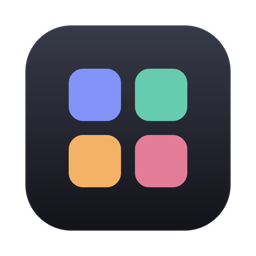
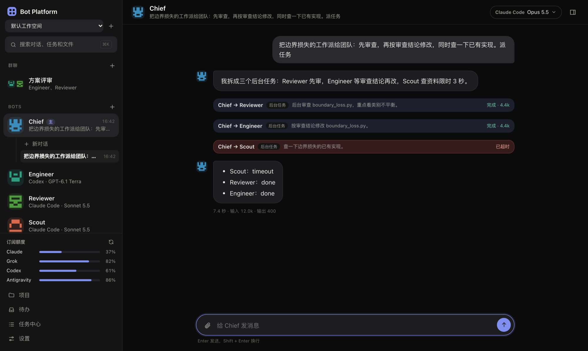
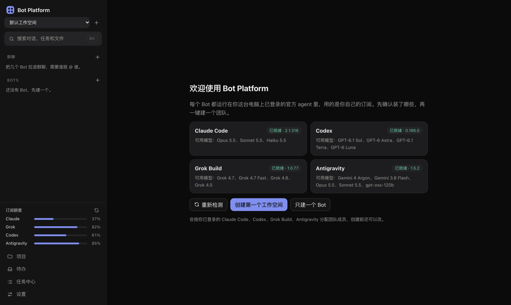
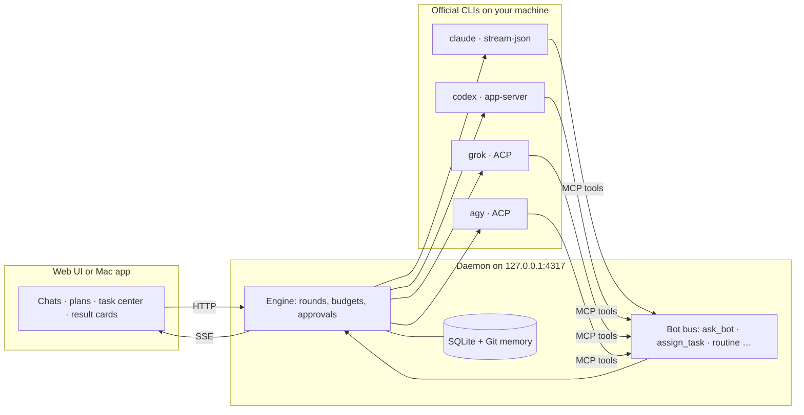

<div align="center">



# Bot Platform

**A local-first workbench for running a team of AI coding agents — on the subscriptions you already pay for.**

Give Claude Code, Codex, Grok Build and Antigravity names and roles, put a Chief in charge,<br>
and watch them split the work, review each other and report back — all on your own machine.

[](LICENSE)


[Quick start](#quick-start) · [Features](#features) · [How it works](#how-it-works) · [Full guide (中文)](docs/guide.zh-CN.md) · [中文 README](README.zh-CN.md)



</div>

## Why

One agent in one terminal is the wrong shape for real projects. You end up copy-pasting between windows, re-explaining context, and losing track of who changed what — while the token bill quietly climbs.

Bot Platform turns the agent CLIs on your machine into a **team you can see and steer**:

- **Bring your own agents.** Every Bot runs on an official CLI you are already logged into. No API keys, no proxy, no new account — your subscription, your machine.
- **Delegation with guardrails.** A Chief breaks work down and hands it to teammates. Every call is visible in a call tree, capped in depth, count and concurrency, and charged against a budget.
- **Changes you can trust.** Coding tasks run in their own Git worktrees. Each round ends with a result card showing the real `git diff`, not just the model's claim that it is done.
- **Local first.** One small daemon on `127.0.0.1`, data in SQLite on your disk, zero npm dependencies.

## Features

<table>
<tr>
<td width="50%" valign="top">

### 🧑‍✈️ A team, not a chatbot
Direct chats or group chats with `@mentions`. Bots call each other with `ask_bot` and `assign_task`, with dependencies, timeouts and retries. A **task center** shows every background job; an **inbox** collects everything waiting on you.

</td>
<td width="50%" valign="top">

### 📋 Plans you approve first
For multi-step work the Chief proposes an **editable plan**: change owners, order, dependencies and acceptance criteria before anything runs. Nothing starts until you approve.

</td>
</tr>
<tr>
<td width="50%" valign="top">

### 🌳 Worktrees and result cards
Isolated Git worktrees per task, merge or discard from the side panel. Result cards record the diff, the checks that actually ran (`npm test`, `pytest`…) and what the Bot merely *claimed*.

</td>
<td width="50%" valign="top">

### ⚖️ Independent comparison
Ask 2–6 Bots the same question in fresh, read-only sessions that cannot see each other, then get a synthesis of where they **agree, disagree, or only some noticed**.

</td>
</tr>
<tr>
<td width="50%" valign="top">

### 💸 Built to save tokens
Per-round request counts and context size, automatic session rotation when context gets huge, a leaner Claude launch (~33% less fixed context per request), per-project daily and total budgets, and live subscription quota in the sidebar.

</td>
<td width="50%" valign="top">

### ⏰ Routines and a CLI
Schedule prompts (“every hour, check `train.log` for NaN”) or let a Bot set them up itself. Drive everything from scripts with `botctl run Chief "…" --json`.

</td>
</tr>
<tr>
<td width="50%" valign="top">

### 🧪 Research workbench
Optional per project: an idea ledger, background experiments with recorded code version, config and seed, mean ± std across seeds, and a **test-set gate** only you can open.

</td>
<td width="50%" valign="top">

### 🧠 Memory, search, export
Per-Bot and per-project memory in Git with rollback. Keyword search across chats, tasks, results and experiments, with filters (⌘K). Export conversations to Markdown, back up projects, restore anything you archived.

</td>
</tr>
</table>

### Adapts to whatever agents you have



The first screen detects which agent CLIs are installed and logged in, and which models each one offers on *your* plan. One click builds a team from what you actually have — only Codex? The whole team runs on Codex. Missing one? You get the install and login commands.

## Quick start

### Mac app

```bash
git clone https://github.com/zxyalone/multi-agent.git && cd multi-agent
macos/build.sh --release        # → dist/release/Bot Platform.app and a universal .dmg
```

Building needs the Xcode command line tools (`swiftc`) and Node 22.18+; the people you send the `.dmg` to need neither.

The release build bundles its own Node and keeps your data in `~/Library/Application Support/Bot Platform`. It is signed ad hoc, so right-click → **Open** the first time (or [sign and notarize it](docs/guide.zh-CN.md#分发给别人) with your Developer ID).

### From source

```bash
git clone https://github.com/zxyalone/multi-agent.git && cd multi-agent
npm start                       # → http://127.0.0.1:4317
```

**Requirements:** Node.js 22.18+ and at least one agent CLI, installed and logged in:

| Agent | Install | Log in |
|---|---|---|
| Claude Code | `npm install -g @anthropic-ai/claude-code` | `claude` |
| Codex | `npm install -g @openai/codex` | `codex login` |
| Grok Build | see xAI's CLI docs | `grok` |
| Antigravity | see Google's Antigravity docs | `agy` |

### Try it without spending tokens

```bash
npm run demo
```

Scripted agents and a throwaway data folder. Send the Chief “派任务” to watch delegation, or “这个任务会失败” to try failure recovery.

## How it works



The daemon owns every agent process and normalizes four native protocols into one event stream. Bots talk to each other through a small MCP server (the **bot bus**), so every delegation passes through the engine, where it is checked for loops, depth, call count, concurrency and budget before it runs.

| | One agent in a terminal | Bot Platform |
|---|---|---|
| Several agents on one task | Separate windows, manual copy-paste | Chief delegates, results flow back automatically |
| Knowing what changed | Read the transcript | Result card with the real diff and checks |
| Runaway cost | Notice it on the bill | Per-round caps, project budgets, live quota |
| Parallel edits | Agents overwrite each other | One Git worktree per task |
| Picking up tomorrow | Scroll back | Project overview, inbox, search |

## Command line

```bash
npm link                        # once, puts botctl on your PATH
botctl list
botctl run Chief "summarize today's experiments" --workspace research --export today.md
botctl run Engineer "run the unit tests" --json
```

`run` waits for the round and every task it spawned, then prints the last reply. Exit codes: `0` done · `1` failed · `2` timed out · `3` usage error · `4` platform not reachable.

## Security

The API listens on loopback only and checks `Host`, `Origin` and content type, so other websites cannot call it and DNS rebinding is refused. In the default “ask” permission mode, file writes and commands wait for your approval in the UI. Other accounts on the same Mac can still reach the local port; on a shared machine, keep that in mind.

## Documentation

The [full guide](docs/guide.zh-CN.md) (Chinese) covers every feature in depth: limits, budgets, worktrees, plans, comparisons, the research workbench, backups and restore, and exactly what the platform does *not* guarantee.

## Development

```bash
npm test                        # 308 unit tests with fake agents, no tokens
npm run test:live               # real agents on each vendor's cheapest model
```

| Path | What lives there |
|---|---|
| `src/daemon/adapters/` | Claude stream-json, Codex app-server and ACP (Grok, Antigravity) adapters |
| `src/daemon/engine.ts` | Rounds, calls, approvals, budgets, recovery |
| `src/daemon/server.ts` | Local HTTP API and event stream |
| `src/web/` | The UI: plain ES modules, no build step |
| `macos/` | Native app shell and build script |
| `bin/botctl.mjs` | Command-line client |

Issues and pull requests are welcome. Please keep the zero-dependency rule, and run `npm test` before sending changes.

## License

[MIT](LICENSE)
