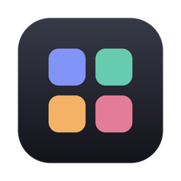
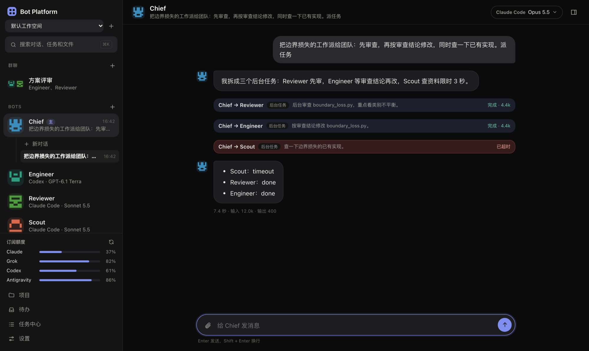
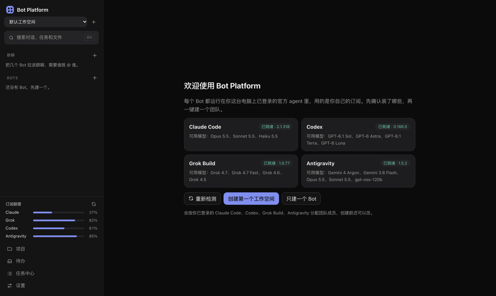
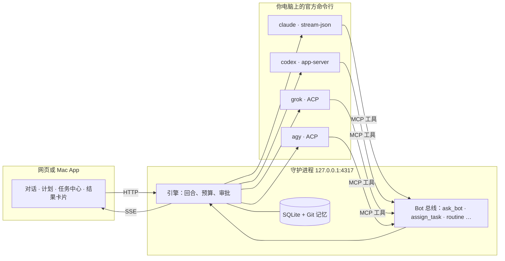

<div align="center">



# Bot Platform

**在自己电脑上指挥一支 AI 编程团队，用的是你已经付费的订阅。**

给 Claude Code、Codex、Grok Build 和 Antigravity 起名字、分角色，让 Chief 统筹，<br>
看它们拆分任务、互相审查、汇报结果。一切都在你的电脑上完成。

[](LICENSE)


[快速开始](#快速开始) · [功能](#功能) · [工作原理](#工作原理) · [完整使用指南](docs/guide.zh-CN.md) · [English](README.md)



</div>

## 为什么做它

真实项目里，一个终端开一个 agent 是不够用的：你要在几个窗口之间来回复制粘贴，反复交代背景，搞不清是谁改了什么，token 账单还在悄悄上涨。

Bot Platform 把你电脑上的 agent 命令行变成一支**看得见、管得住的团队**：

- **用你自己的 agent。** 每个 Bot 都运行在你已登录的官方命令行里。不需要 API key，不经过代理，不用注册新账号。用的是你的订阅，跑在你的电脑上。
- **有护栏的分工。** Chief 拆解任务、派给队友。每次调用都显示在调用链里，深度、次数和并发都有上限，并计入预算。
- **改动看得见。** 写代码的任务在独立的 Git 工作树里进行。每一轮结束都有结果卡片，显示真实的 `git diff`，而不只是模型说“做完了”。
- **本地优先。** 一个只监听 `127.0.0.1` 的小守护进程，数据存在本机的 SQLite，零 npm 依赖。

## 功能

<table>
<tr>
<td width="50%" valign="top">

### 🧑‍✈️ 是团队，不是聊天机器人
私聊，或者在群聊里 `@` 成员。Bot 之间用 `ask_bot` 和 `assign_task` 互相调用，支持依赖、超时和重试。**任务中心**列出所有后台任务，**待办**集中所有等你处理的事。

</td>
<td width="50%" valign="top">

### 📋 先批准，再执行
多步骤的工作，Chief 会先提出**可编辑的执行计划**。负责人、顺序、依赖和验收条件都能改，你批准之前什么都不会开始。

</td>
</tr>
<tr>
<td width="50%" valign="top">

### 🌳 工作树和结果卡片
每个任务有独立的 Git 工作树，在侧栏合并或丢弃。结果卡片记下真实改动、实际跑过的检查（`npm test`、`pytest` 等），以及哪些只是 Bot 的“自述”。

</td>
<td width="50%" valign="top">

### ⚖️ 独立比较
让 2 到 6 个 Bot 在互相看不到的新会话里只读地回答同一个问题，再归纳出**一致、分歧和只有部分提到**的地方。

</td>
</tr>
<tr>
<td width="50%" valign="top">

### 💸 为省 token 而设计
每轮显示请求次数和上下文大小；上下文过大时自动换新会话；Claude 精简启动，每次请求的固定上下文少约三分之一；项目有每日和总预算，侧栏实时显示订阅额度。

</td>
<td width="50%" valign="top">

### ⏰ 定时任务和命令行
定时给 Bot 发一段话，比如“每小时看一下 `train.log` 有没有 NaN”，也可以让 Bot 自己设。脚本里用 `botctl run Chief "…" --json` 驱动一切。

</td>
</tr>
<tr>
<td width="50%" valign="top">

### 🧪 实验工作台
按项目开启：想法账本、后台实验（自动记录代码版本、配置和种子）、多种子的均值和标准差，以及只有你能打开的**测试集闸门**。

</td>
<td width="50%" valign="top">

### 🧠 记忆、搜索、导出
每个 Bot、每个项目都有可回滚的 Git 记忆。按关键词搜索对话、任务、结果和实验，可筛选（⌘K）。对话导出为 Markdown，项目可备份，归档的东西都能恢复。

</td>
</tr>
</table>

### 适配每个人自己的 agent



第一次打开时，平台会检测装了哪些 agent 命令行、是否已登录，以及在*你的*套餐下各自能用哪些模型，然后一键按你实际拥有的 agent 组建团队。只装了 Codex？整个团队都用 Codex。缺哪个，就给出对应的安装和登录命令。

## 快速开始

### Mac App

```bash
git clone https://github.com/zxyalone/multi-agent.git && cd multi-agent
macos/build.sh --release        # 生成 dist/release/Bot Platform.app 和通用 .dmg
```

构建需要 Xcode 命令行工具（`swiftc`）和 Node 22.18 以上；收到 `.dmg` 的人两样都不需要。

发行版自带 Node，数据放在 `~/Library/Application Support/Bot Platform`。它只做了本地签名，第一次打开时请在 Finder 里右键选“打开”，也可以用你的 Developer ID [签名并公证](docs/guide.zh-CN.md#分发给别人)。

### 从源码运行

```bash
git clone https://github.com/zxyalone/multi-agent.git && cd multi-agent
npm start                       # 打开 http://127.0.0.1:4317
```

**需要：** Node.js 22.18 以上，以及至少一个已安装并登录的 agent 命令行：

| Agent | 安装 | 登录 |
|---|---|---|
| Claude Code | `npm install -g @anthropic-ai/claude-code` | `claude` |
| Codex | `npm install -g @openai/codex` | `codex login` |
| Grok Build | 见 xAI 的命令行文档 | `grok` |
| Antigravity | 见 Google 的 Antigravity 文档 | `agy` |

### 不花 token 先试试

```bash
npm run demo
```

使用脚本 agent 和临时数据目录。给 Chief 发“派任务”可以看分工，发“这个任务会失败”可以试失败恢复。

## 工作原理



守护进程管理所有 agent 进程，把四种原生协议统一成一条事件流。Bot 之间通过一个小型 MCP 服务（**Bot 总线**）通信，所以每一次派活都要经过引擎：先检查是否成环、深度、调用次数、并发和预算，才会真正执行。

| | 终端里单开一个 agent | Bot Platform |
|---|---|---|
| 多个 agent 做一件事 | 开几个窗口，手动复制粘贴 | Chief 分派，结果自动回流 |
| 知道改了什么 | 翻对话记录 | 结果卡片里的真实改动和检查 |
| 花费失控 | 看到账单才发现 | 单轮上限、项目预算、实时额度 |
| 同时改代码 | 互相覆盖 | 每个任务一个 Git 工作树 |
| 第二天接着做 | 往上翻 | 项目概览、待办、搜索 |

## 命令行

```bash
npm link                        # 只需一次，把 botctl 加到 PATH
botctl list
botctl run Chief "汇总今天的实验结果" --workspace 研究 --export today.md
botctl run Engineer "跑一下单元测试" --json
```

`run` 会等这一轮和它派出的所有任务结束，再输出最后一条回复。退出码：`0` 完成 · `1` 失败 · `2` 超时 · `3` 用法错误 · `4` 连不上平台。

## 安全

接口只监听本机，并校验 `Host`、`Origin` 和请求类型，其他网站无法调用它，DNS 重绑定也会被拒绝。在默认的“每次询问”权限下，改文件和运行命令都要你在界面上批准。同一台 Mac 上的其他账户仍能访问本机端口，多人共用一台电脑时请注意。

## 文档

[完整使用指南](docs/guide.zh-CN.md)详细说明每个功能：各种上限、预算、工作树、执行计划、独立比较、实验工作台、备份和恢复，以及平台*不*保证的事情。

## 开发

```bash
npm test                        # 308 个单元测试，用假 agent，不花 token
npm run test:live               # 调用真实 agent，每家用最便宜的模型
```

| 路径 | 内容 |
|---|---|
| `src/daemon/adapters/` | Claude stream-json、Codex app-server 和 ACP（Grok、Antigravity）适配器 |
| `src/daemon/engine.ts` | 回合、调用、审批、预算、恢复 |
| `src/daemon/server.ts` | 本机 HTTP 接口和事件流 |
| `src/web/` | 界面：原生 ES 模块，无需构建 |
| `macos/` | 原生 App 外壳和构建脚本 |
| `bin/botctl.mjs` | 命令行客户端 |

欢迎提 Issue 和 Pull Request。请保持零依赖，提交前先跑 `npm test`。

## 许可证

[MIT](LICENSE)
